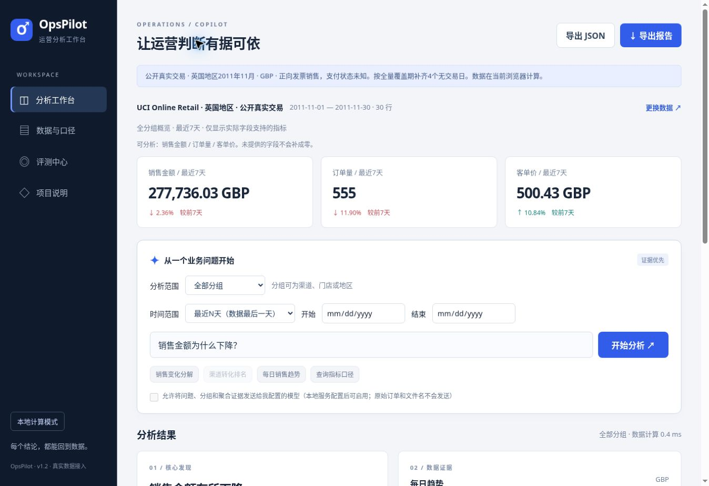

# OpsPilot · 真实业务数据分析 Copilot

**上传自己的销售/渠道报表，先检查口径，再输出可复算的指标、图表与报告。**

版本 **1.2.0**。可用于个人本地或受控小团队试点，AI辅助开发。在线默认使用有来源的**UCI真实零售交易**，也可上传自己的CSV/Excel。合成漏斗仅作为历史回归样例保留。

[在线私有工作台](https://opspilot-zhou-0922.zho12.chatgpt.site) · [真实数据接入](docs/REAL_DATA.md) · [PRD](docs/PRD.md) · [数据契约](docs/DATA_CONTRACT.md) · [部署指南](docs/DEPLOYMENT.md) · [API](docs/API.md) · [架构](docs/ARCHITECTURE.md)



## 直接使用

在线工作台支持真实数据的浏览器内计算，不需要模型密钥，刷新后清除上传内容。私有访问由现有Site访问权限控制。

本机运行需要 **Python3.11+、Node20+**，无第三方运行依赖：

```bash
git clone https://github.com/Casper032517ZLOVEYL/-.git opspilot
cd opspilot
python server.py
```

打开http://127.0.0.1:8501。仓库当前私有，克隆需要自己的GitHub访问权限。

## 把自己的数据跑起来

1. 点击“更换数据”，选择CSV/TSV/XLSX。确认编码、日期格式、币种与金额口径。
2. 选择**日×分组汇总**或**订单明细（一行一单）**，映射日期和实际存在的数值字段。分组可以是渠道、地区、门店；没有时用全部业务。
3. 检查问题清单并修复。重复订单、空金额和日期歧义会阻止导入；默认不填补零值。确认导入后再分析。
4. 问“销售金额趋势”“最近3天订单量”“哪个渠道客单价最高”。支持自选本期日期，自动与前一等长窗口比较。
5. 下载质量报告、标准数据、Markdown/JSON分析报告和明细CSV，与原平台核对。Markdown支持先预览并复制，浏览器限制下载时也可保存内容。

只提供日期和销售金额也能分析销售；没有点击不能算注册转化，没有投放成本不能算ROAS，缺失字段保持null。订单明细按唯一ID计数，不把商品行当订单数。用户须确认已支付状态和导出完整性，系统无法从空日期推断是否漏数。

**本项目无需把真实业务文件上传GitHub。** 未映射的姓名、手机号、地址等列在导入后丢弃，订单ID仅用于当前导入去重。默认上传文件只存在当前浏览器内存，分析不自动落盘。

## 用真实公开交易验证

内置案例来源：[UCI Online Retail](https://archive.ics.uci.edu/dataset/352/online+retail)，Chen (2015)，[CC BY4.0](https://creativecommons.org/licenses/by/4.0/)。从54万行官方原档中选取英国地区2011年11月，排除取消/非正数量/非正单价，按发票汇总为2,490个订单和26个有交易日。

|核对窗口|正向销售额（GBP）|
|---|---:|
|2011年11月|1,325,346.21|
|11月24日至30日|277,736.03|
|11月17日至23日|284,447.21|

按原公开全量覆盖期明确补齐4个无交易日。这里的分组是**地区**，不是营销渠道；没有支付状态，不能称作已支付GMV或净收入。原档SHA256、转换过程、排除行数、派生文件哈希和独立Decimal校验见[真实数据记录](docs/REAL_DATA.md)。不包含客户ID或商品描述。

这些结果证明真实公开数据路径已跑通，尚未验证用户公司的业务报表、真实用户效率或业务收益。

## 功能与边界

|能力|当前实现|
|---|---|
|真实文件接入|5MB、20,000行、20分组；CSV UTF-8/GB18030和三种分隔符；XLSX首表|
|可配置口径|字段映射、日期/Excel序号、单币种、状态筛选、同口径漏斗可选|
|数据质量|行号问题清单、重复/缺失检查、显式聚合/补零、导入失败保留原数据|
|分析|销售、订单、注册、成本、CTR、CVR、ROAS、客单价；仅开放有数据的指标|
|时间与证据|最近N天或自选1–90天、等长比较、趋势、分组排名、贡献和10%规则预警|
|交付|质量JSON、标准CSV、Markdown报告、分析JSON、渠道CSV|
|可选模型|一次调用，结构化待验证假设，数值不可覆盖，失败保留计算|
|受控部署|独立WSGI/Gunicorn入口、Basic登录、Host白名单、来源/体积/并发限制|

商品行、多币种、负退款、跨时区日志先按业务规则处理；无同比、预测、用户留存、因果识别、平台API自动同步或任意代码执行。有限规则处理自然语言，复杂问题需拆分。详细契约见文档。

## 可选模型：默认不发送

```bash
cp .env.example .env
```

在.env填写自己的兼容Chat Completions端点、模型与密钥，再重启`python server.py`：

```dotenv
OPSPILOT_API_KEY=填写自己的密钥
OPSPILOT_MODEL=填写自己的模型ID
OPSPILOT_BASE_URL=https://api.openai.com/v1
OPSPILOT_TIMEOUT_SECONDS=20
```

界面仍然默认关闭AI。只有勾选发送授权后才调用同源API；服务端发送问题、分组、聚合指标、币种和知识证据，**不发送原始订单、订单ID、未映射列或文件名**。如果问题/分组本身含敏感信息，须先自行脱敏或保持AI关闭。

端点须支持JSON response_format。密钥只在服务端，.env被Git忽略。模型只能输出最多3条待验证假设与验证步骤，不能生成或执行分析代码；引用ID校验不等于假设已被证明。未知用量/价格显示null，不虚构费用。尚未进行真实付费模型的质量评测。

## 受控部署

Linux部署使用Gunicorn，**不要把开发server.py直接暴露公网**：

```bash
python -m venv .venv
. .venv/bin/activate
pip install -r requirements-server.txt
# 编辑.env，配置自己的登录用户名及至少12位强密码。
gunicorn --bind 127.0.0.1:8501 --workers 1 --threads 4 --timeout 90 'opspilot.wsgi:create_app()'
```

已实际启动固定版本Gunicorn26.2.0，核对登录保护、静态页面和真实数据分析。仓库也提供Dockerfile与Compose配置；当前环境无Docker，镜像构建尚未实测。域名部署须配HTTPS代理、请求/登录限流和明确的可信Host，详见[部署指南](docs/DEPLOYMENT.md)。

当前是共享账号、无持久化数据的小团队试点入口，尚无多租户、逐用户权限、SSO和审计。在线私有工作台仍为浏览器计算版，未部署Python模型后端。

## 验证

```bash
npm test
python -m unittest discover -s tests -p 'test_*.py' -v
# 装了requirements-server.txt后执行真实Gunicorn进程冒烟：
python tests/smoke_gunicorn.py
```

- 132项历史参数化回归，24项分析/导出检查。
- 34项真实数据导入、字段/金额/日期/覆盖/订单边界与公开样例校验。
- 50项Python模型/配置/API/认证/部署与独立Decimal核对。
- 真实浏览器验证CSV、XLSX订单导入及自选日期；GitHub Actions配置检查Node20/22、Python3.11/3.12和Gunicorn入口。

上述240项自动检查不代表模型准确率或用户任务成功率。Actions执行状态以仓库为准；本地通过不等于云端已通过。后续真实模型/用户任务验收清单见[人工评审](docs/HUMAN_EVAL.md)。

## 结构

```text
dist/
  app.mjs / import-ui.mjs      工作台与导入交互
  lib/importer.mjs             两类真实数据适配与质量报告
  lib/data.mjs / engine.mjs    标准数据校验与确定性计算
  lib/catalog.mjs / router.mjs 指标口径与受限计划
  lib/charts.mjs / reports.mjs 图表与导出
  datasets/                    有来源、哈希与许可的公开真实数据
opspilot/
  http_api.py / service.py     共享校验、引擎调用与模型编排
  wsgi.py                     带认证的部署入口
  config.py / model.py         服务端模型配置与结构化输出
server.py                     仅本机开发入口
tools/                        共享引擎CLI与公开数据准备脚本
tests/ / evaluation/           自动检查、真实HTTP与人工评测协议
docs/                         当前文档与历史资料
Dockerfile / compose.yaml     受控部署配置（容器未实测）
```

旧PDF、SVG、视频在docs/archive与docs/assets，描述1.0历史版本；当前能力以1.2文档和代码为准。代码未授予开源许可证，仓库保持私有；UCI派生数据遵循其独立CC BY4.0许可。
