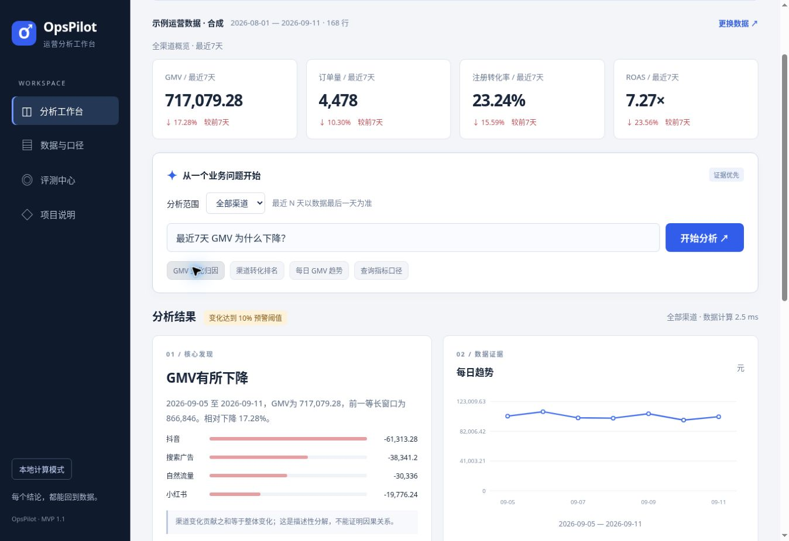

# OpsPilot · 运营数据分析 Copilot

**把运营问题变成可复算的指标、图表与待验证假设。**

个人 AI 产品实践项目，使用 AI 辅助开发。在线 Demo 为确定性计算；本地可配置兼容 Chat Completions 的模型 API。当前版本 **1.1.0**。

[产品PRD](docs/PRD.md) · [架构设计](docs/ARCHITECTURE.md) · [数据契约](docs/DATA_CONTRACT.md) · [API](docs/API.md) · [评测协议](evaluation/PROTOCOL.md) · [版本记录](CHANGELOG.md)

> **状态说明**：132项回归 + 24项新增分析/导出测试 + 27项后端/本地模拟API测试，共183项本地测试通过。示例业务数据均为合成。尚未进行真实付费模型质量评测、真实用户访谈或业务收益验证；这些测试数不能当作大模型准确率。



## 先运行

需要 **Python 3.11+** 和 **Node.js 20+**。无第三方运行依赖，不需要 npm install 或 pip install。

```bash
python server.py
```

打开 **http://127.0.0.1:8501**，即可用内置示例开始分析。不要双击HTML文件，模块和样例数据需要HTTP服务。

如果从当前仓库克隆：

```bash
git clone https://github.com/Casper080117/-.git opspilot
cd opspilot
python server.py
```

仓库使用已有私有仓库保存，访问与克隆需要账号权限。在线私有演示：<https://opspilot-zhou-0922.zho12.chatgpt.site>，适合由项目拥有者自己演示。

## 能做什么

|用户任务|产品能力|
|---|---|
|上传渠道报表|CSV / XLSX首表、中文字段映射、粒度与漏斗校验|
|询问指标变化|GMV、订单、注册、成本、CTR、CVR、ROAS、客单价|
|定位变化来源|最近N天等长比较、渠道贡献、10%规则预警|
|查看渠道表现|全部渠道排名或单渠道筛选、每日趋势图|
|核查依据|实际时间范围、公式、明细、口径知识ID|
|导出复盘|Markdown报告、明细CSV和完整JSON|
|补充分析方向|可选一次模型调用，输出结构化待验证假设|
|形成迭代证据|浏览器反馈导出、可复现回归与人工评审清单|

可直接尝试：

- `最近7天 GMV 为什么下降？`
- `哪个渠道注册转化率最高？`
- `抖音最近7天GMV`
- `最近一周订单量`
- `最近14天 GMV 趋势`
- `ROAS 是什么？`

一次只分析一个指标和一个最近N天窗口。多个指标或多个窗口会要求澄清；同比、指定月份、预测、留存、因果和用户分群暂不支持。

## 一个具体结果

合成样例包含2026-08-01至2026-09-11的42天、4渠道、168行数据。最新7天：

|指标|本期|前期|说明|
|---|---:|---:|---|
|GMV|717,079.28元|866,846.00元|相对下降17.28%|
|抖音GMV|106,182.72元|167,496.00元|相对下降36.61%|

系统能计算渠道对变化的贡献，但不能仅凭贡献认定某次活动或落地页造成变化。下一步需要补充业务记录或实验验证。

## 可选：启用真实模型

复制 `.env.example` 为 `.env`，填入自己的配置后重启服务：

```dotenv
OPSPILOT_API_KEY=填写自己的密钥
OPSPILOT_MODEL=填写兼容模型ID
OPSPILOT_BASE_URL=https://api.openai.com/v1
OPSPILOT_TIMEOUT_SECONDS=20
```

已有进程环境变量优先于.env。密钥只存在服务端，.env已被Git忽略。模型端点需支持JSON response_format；不兼容、超时或返回未知引用时，界面提示回退并保留计算结果。

只发送问题、聚合指标、渠道明细和知识条目，不发送原始逐行数据或文件名。模型仅提供**待验证假设与验证步骤**，不重算或覆盖工具数值。引用ID校验不代表假设已经得到语义验证，仍需人工复核。

可选填写当前提供方每百万Token美元单价：

```dotenv
OPSPILOT_INPUT_USD_PER_MILLION=
OPSPILOT_OUTPUT_USD_PER_MILLION=
```

未知用量或价格显示为空，不能将其解释为零费用。在线静态演示没有模型密钥；配置能力在本地服务中使用。

## 数据口径

一行=自然日×渠道。八个字段均必填：`date, channel, impressions, clicks, registrations, orders, revenue, cost`。

- 日期格式 YYYY-MM-DD，日期和渠道唯一。
- 曝光≥点击≥注册≥订单，必须来自同口径漏斗。全站老用户订单与当日新用户注册混在一起的报表不可直接导入。
- GMV为已支付金额，单位人民币，不等于净收入或利润。
- 整体比率使用总分子/总分母；零分母显示不可计算。
- 窗口内每个日渠道组合都必须存在；没有活动填零，缺失不能自动填零。
- 筛选渠道后仍以全数据最大日期为锚点，避免漏数被隐藏。
- 上传上限5MB、20,000行、20渠道。XLSX拒绝公式和布尔业务字段，读取首表；复杂工作簿可先转UTF-8 CSV。

重建合成数据：`python tools/generate_data.py`，固定随机种子20260922。

## 设计取舍

业务口径、文件校验和数值计算放在确定性工具中；小型知识库使用关键词检索。浏览器、Node CLI与Python服务复用同一套指标引擎。

这是一套受控分析工作流，不是任意执行代码的自主Agent，也未部署向量数据库。1.1版本移除了重复的大模型计划调用，每个有效分析至多一次模型解释调用，减少不必要的成本与延迟。是否增加语义计划器或混合检索，取决于真实问题覆盖与评测。

## 测试与评测

```bash
npm test
python -m unittest discover -s tests -p 'test_*.py' -v
```

- `evaluation/run.mjs`：132项参数化算例，gold独立定义，生成逐项结果和页面回归摘要。
- `tests/analytics.test.mjs`：24项渠道范围、计划、导出和边界测试。
- `tests/test_backend.py`：27项配置、真实本地HTTP、模拟模型返回与回退测试。
- `.github/workflows/ci.yml`：Node20/22与Python3.11/3.12的自动检查配置。
- `docs/HUMAN_EVAL.md`：20条真实模型待测清单；不填写虚构分数。

工具延迟仅是Node进程内耗时；不包含模型或网络。GitHub CI执行结果以仓库Actions页为准，本地通过不等于云端已运行。

## 项目结构

```text
dist/
  core.mjs            共享导出入口
  app.mjs             页面交互
  lib/                口径 / 校验 / 路由 / 计算 / 图表 / 报告
  xlsx.mjs            只读工作簿解析
  sample.csv          合成业务数据
opspilot/             Python配置、模型客户端和服务编排
server.py             本地HTTP入口
tools/                共享引擎CLI、合成数据生成器
tests/                分析、导出、配置和API测试
evaluation/           回归、实际结果、聚合反例和评测协议
docs/                 当前PRD、数据契约、架构、API与人工清单
  archive/            1.0历史PDF资料，不是当前版本验收记录
  assets/             原型、演示资料
```

## 已知边界与后续计划

- 有限语言规则覆盖固定任务，不能把所有运营问题自动转成计划。
- 缺少真实访谈和端到端模型效果，尚不能宣称提高业务效率或收益。
- 模型文本仍可能包含无依据假设，需人工复核；无自动预算执行。
- 本地服务无多用户认证、企业审计、流式输出或取消机制，不应直接暴露到公网。
- 历史SVG可导入Figma，未生成原生.fig；历史视频为界面截图导览。
- 代码未设置开源许可证；当前仓库保留私有访问。

下一步先用5位目标用户的真实任务验证流程，再根据失败样例扩充路由与知识检索。
