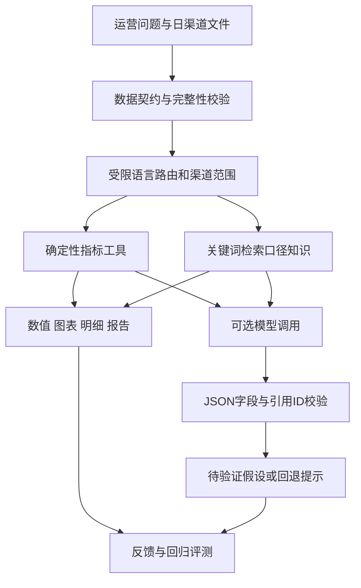

# 产品与实现架构

## 职责边界

- `dist/lib/catalog.mjs`：指标和6条口径知识。
- `dist/lib/data.mjs`：CSV解析、字段映射、粒度和数值校验。
- `dist/lib/router.mjs`：有限自然语言与结构化计划白名单。
- `dist/lib/engine.mjs`：时间窗口、渠道范围、汇总、贡献、排名和预警。
- `dist/lib/charts.mjs`：纯SVG可视化，标签转义。
- `dist/lib/reports.mjs`：Markdown与CSV导出，防止表格公式注入。
- `dist/app.mjs`：页面状态与交互。
- `opspilot/config.py`：环境配置与本地.env读取。
- `opspilot/model.py`：一次Chat Completions请求、结构化输出和引用校验。
- `opspilot/service.py`：Node工具调用、回退、用量与费用。
- `server.py`：仅本地HTTP服务、输入限制、来源检查和并发上限。

`dist/core.mjs` 是稳定导出入口；浏览器、CLI和Python服务通过同一引擎计算指标。真实业务数值不会由模型重算或覆盖。

## 模型调用契约

输入：问题、计划、时间窗口、汇总指标、渠道明细、公式、相关口径。原始逐行记录和文件名不发送给模型。渠道名和问题本身仍可能包含业务信息，开启前使用合适数据。

输出：`{"hypotheses":[{"hypothesis":"…","validation":"…","evidence_ids":["K03"]}]}`。最多3条，文本长度和引用ID须通过校验；允许空数组表示依据不足。ID有效不等于语义被证明，模型假设仍需人工复核。

未配置密钥时使用浏览器计算；配置后本地服务每题调用一次模型。兼容端点必须支持JSON response_format。模型超时、非法JSON、未知引用时回退工具结果。未提供Token用量或价格时费用为null，不能写成0。

## 范围说明

这是受控工具工作流，不是自由执行Agent。知识检索为关键词匹配，不是向量RAG。在线静态Demo没有模型密钥，真实API连接在本地配置。`docs/archive`与原SVG原型是1.0历史资料，当前设计以本目录Markdown与实际代码为准。
