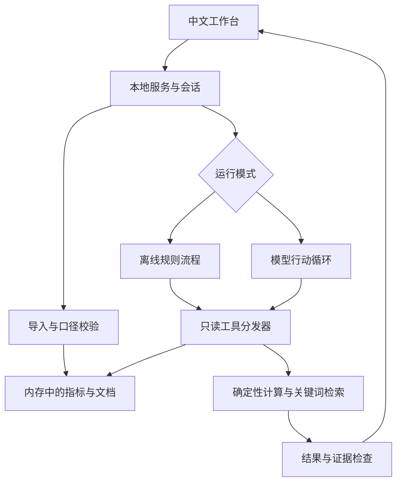

# 架构与工具协议

## 模块关系



模型调用外部配置端点；它本身没有文件系统、网络抓取、shell或交易权限。工具执行、证据ID登记和结果验证都在本地服务内。

## 行动协议

为降低提供商适配成本，使用Chat Completions的JSON输出。每次只允许一个动作，工具结果作为标明“不可信数据”的消息回传；不是原生function calling。

```json
{"action":"tool","tool":"calculate_metrics","arguments":{"company":"Apple"},"note":"检查历史指标与同比"}
```

```json
{"action":"finish","summary":"已完成指标核对","findings":[{"kind":"calculation","text":"这里填写依据实际工具结果生成的结论","evidence_ids":["实际返回的ID"]}],"open_questions":["仍缺少的资料"]}
```

|工具|输入|返回与约束|
|---|---|---|
|list_companies|空对象|公司名单、文档片段数|
|calculate_metrics|company字符串|该公司各期间的原值、同比、净利率、口径提示与引用ID|
|search_documents|query字符串|最多4个关键词匹配片段；查询最多200字符|
|read_evidence|evidence_id字符串|只允许读取本轮已经返回的ID|

模型可在计算后改查文档，再决定结束。工具异常进入记录并反馈，模型可换参数。模型网络错误停止；不自动重发付费请求。90秒预算为轮次之间的软检查，8次调用为硬轮次数上限。

## 上下文

当前上传资料存在服务器会话；每次分析建立新的工具箱和本轮证据集合。最近4轮只保存问题及最多1000字符的摘要，不保存完整报告和全部工具输出，因此追问可能需要重新检索。导入新资料时清空历史，避免上一批数据污染结论。

## 证据与可信度

CSV证据包含文件名、行内容、原始来源及位置，ID基于文件内容哈希、文件名和行号。文档ID基于内容哈希、页码和片段偏移。ID是定位标识，不是来源真实性认证。

数值由Decimal计算，并以4位小数舍入，前端显示至2位。同比前期须大于零，使用上年相同财年期间。不同公司的财年终点仍需人工对齐。

报告校验：summary长度、发现数量、发现类型、文本长度、引用是否为本轮暴露ID。**尚不自动证明结论被引用支持，也不能阻止所有Prompt Injection。** 模型摘要与文本结论始终按待复核内容呈现。

## 本机边界

只绑定127.0.0.1；静态文件使用显式白名单；拒绝无效Host、缺失/错误Origin和非JSON写入；会话Cookie为HttpOnly、SameSite=Strict。上传不写磁盘，不调用远端文档URL，不允许网页传入模型端点。模型端点只由本机.env配置，强制HTTPS、禁止重定向。

PDF解析未在独立资源沙箱中运行；只适合可信来源的小文件。本地开发服务不提供生产级拒绝服务防护，不能直接暴露公网。多进程部署、数据库权限和队列并发不属于本版能力。
